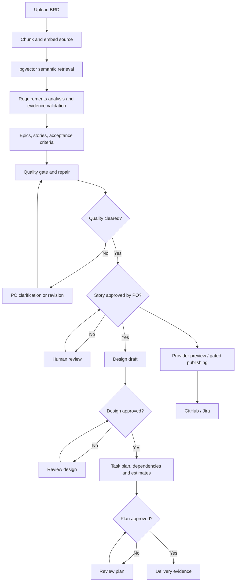

# ReqFlow AI — Consolidated Implementation and Verification Guide

**Project:** Requirements-to-User-Story Automation  
**Scope:** Phases 1–7, including quality corrections, Product Owner review, external publishing, security, solution design, delivery planning and submission verification.  
**Document type:** Technical implementation reference and validation record.  
**Evidence directory:** `data/screenshots/`

## 1. Overview

ReqFlow AI converts business requirements documents into traceable requirements, epics, user stories and acceptance criteria. Subsequent stages generate proposed solution designs and implementation tasks, subject to independent quality and human-approval controls. The solution supports semantic retrieval, evaluation, versioned backlog repair, Jira/GitHub publication, and read-only delivery evidence.

The implemented capstone workflow uses an example **Student Attendance Management System**. Requirements are linked to source evidence, while ambiguous specifications remain unresolved until reviewed. The system distinguishes source-supported extraction, textual quality checks, Product Owner clarification decisions, final story approval, and design/plan approval; none of these statuses should be conflated.

### 1.1 Technology stack

| Layer | Implementation |
|---|---|
| Frontend | React, TypeScript, Vite |
| Application API | Python, FastAPI |
| Agent workflows | LangGraph, local Ollama (`qwen2.5:3b`) |
| Embedding / retrieval | Ollama `nomic-embed-text`, PostgreSQL and pgvector |
| Persistent storage | PostgreSQL; normalized requirements, stories, approvals, publications and delivery artifacts |
| Supporting services | Redis |
| External integration | GitHub Issues, Jira Cloud REST APIs |
| Tool interface | MCP stdio server with an MCP client demo |
| Runtime | Docker Compose |
| Testing | Python `unittest`, authenticated smoke tests, submission and artifact audits |

The design and planning stages use **deterministic, traceable synthesis** of saved analyses and approved stories. They are not independently Ollama-generated technical specifications. Proposed APIs, entities and estimates are technical proposals, not established BRD facts.

### 1.2 Logical workflow



A quality-cleared story is not automatically Product Owner approved. A Product Owner clarification decision is not the same as a final story approval. Provider publishing follows a separate write authorization and idempotency workflow.

## 2. Phase 1 — Application Foundation

The base environment consists of five Compose services: `postgres`, `redis`, `ollama`, `backend` and `frontend`. The backend exposes FastAPI endpoints, the frontend runs on port 3000, and PostgreSQL persists application records. Ollama provides local generation and embedding services; pgvector supports similarity retrieval. Backend and frontend communicate through application API routes.

Basic service checks:

```cmd
 docker compose config --quiet
 docker compose ps
 docker compose exec postgres psql -U reqflow -d reqflow -c "SELECT extname FROM pg_extension WHERE extname='vector';"
 docker compose exec redis redis-cli ping
```

Use `docker compose logs --tail=100 backend` to inspect startup messages. Existing named volumes must be preserved when rebuilding application services. **Do not run `docker compose down -v` on the working environment.**

## 3. Phase 2 — Document Ingestion and Retrieval-Augmented Search

Requirements files are uploaded, chunked and indexed into PostgreSQL using pgvector. Supported demo formats include PDF, DOCX, Markdown and TXT. The embedding model `nomic-embed-text` yields a **768-dimensional vector**; the database schema and runtime embedding configuration must agree. Retrieval results include source filename, chunk identity and similarity score to support subsequent evidence checks.

Document ingestion and retrieval are exercised through the React interface and FastAPI. A verified example uses a synthetic student-attendance BRD; generated source passages must be checked against the uploaded document rather than treated as independent requirements.

Evidence to retain under `data/screenshots/`: indexed document list, the upload completion/chunk count, a retrieval query, and matching passages with source references.

## 4. Phase 3 — Requirements Analysis

The requirements-analysis workflow retrieves relevant source passages and extracts functional, non-functional and business-level requirements. It records evidence status, classification, potential gaps and open questions. Saved analysis can be restored from PostgreSQL and shown in the frontend without rerunning the model.

Extracted requirements and open questions have different meanings: unresolved questions are context for human review and must not be silently promoted into approved implementation scope. Only supported evidence enters the default backlog-generation stage; partially supported content requires an explicit decision.

The demonstration dataset includes business requirement `BRD-ATT-001`, functional IDs `FR-001`–`FR-005` and non-functional IDs `NFR-001`–`NFR-004`. Their classification is inferred partly from ID prefixes and should be reviewed against the original BRD.

## 5. Phase 4 — Epics, User Stories and Quality Assurance

### 5.1 Backlog generation

The LangGraph backlog workflow performs five sequential activities:

1. Epic generation.
2. User-story generation.
3. Given–When–Then acceptance-criteria generation.
4. Fibonacci estimation and dependency drafting.
5. Deterministic backlog quality validation.

The persisted Phase 3 analysis is the source for generation. Priorities and estimates are recommendations until accepted by the appropriate reviewer.

Relevant routes:

```text
POST  /api/v1/projects/{project_id}/backlogs/generate
GET   /api/v1/projects/{project_id}/backlogs
GET   /api/v1/projects/{project_id}/backlogs/{backlog_id}
PATCH /api/v1/projects/{project_id}/backlogs/{backlog_id}/stories/{story_key}/approval
```

The initial Phase 4 schema was introduced in `database/init/005_phase4_backlog.sql`.

### 5.2 Quality gate (Phase 4.1)

The quality validator checks requirement coverage, topic alignment, permission and actor errors, unsubstantiated scope, duplicates, acceptance-criterion testability, estimates and dependency cycles. Backlog retrieval revalidates findings against the saved source analysis. High/critical findings block approval with HTTP 409; unresolved assumptions may result in `review_required`.

Core files include `agents/story_generation/quality.py`, `agents/story_generation/nodes.py`, the backlog API and `tests/test_phase41_quality.py`.

These checks are **heuristics**. A clean result does not prove that a requirement is semantically entailed by its evidence; human review is still required.

### 5.3 Targeted repair (Phase 4.2)

```text
POST /api/v1/projects/{project_id}/backlogs/{backlog_id}/repair
Request: {"use_ollama": true}
```

Repair produces a **new saved backlog version** while retaining the original. Corrections focus on identified issues with traceability, scope, unauthorized actions, duplication, testability and dependency ordering. The Ollama-enabled path may improve source-derived wording, subject to deterministic checks; a local-only fallback is also available with `use_ollama:false`.

The repaired version records lineage using `repair_of_backlog_id`, `repair_version` and `repair_audit`. Approval statuses on the original are not silently copied onto the new version. Missing NFR targets remain open decisions, and no repair automatically constitutes Product Owner approval.

### 5.4 Story-level clearance (Phase 5.1)

The `story_clearance.py` service calculates three statuses: `quality_cleared`, `review_required`, `blocked`. Low-severity estimation observations can coexist with clearance; unresolved assumptions or high/critical findings cannot. The API exposes `story_clearances` alongside saved backlog stories.

**Preview** requires story quality clearance but not final PO approval. **Live publishing** requires both quality clearance and final `approved` status, plus an explicit server-side publishing switch and key. The quality status is recomputed rather than assumed from a stored approval label.

## 6. Phase 5 — MCP, GitHub and Jira Integration

The publishing subsystem uses a shared validation and provider-adapter service. The React application invokes FastAPI; separately, the MCP stdio server exposes provider functionality to compatible MCP clients. The UI's ordinary HTTP actions do **not** themselves call MCP.

### 6.1 MCP tools

| Tool | Purpose |
|---|---|
| `preview_quality_cleared_story` | Format and validate a source-linked story without external writes |
| `publish_approved_story` | Publish one eligible, approved story, subject to live-writing safeguards |
| `list_story_publications` | List existing provider publication records |

The initial preview tool was renamed as part of story-level clearance. The current client demonstration discovers the current names and calls only the read-only preview tool.

### 6.2 GitHub and Jira providers

The publishing service supports a GitHub Issue or Jira Task and includes a traceable `ReqFlow-Origin` marker in the content. Native epic hierarchies, issue updates, bidirectional synchronization and provider OAuth flows are not implemented as complete product features. Provider-specific configuration lives in `.env` and must not be committed.

```text
POST /api/v1/projects/{project_id}/backlogs/{backlog_id}/publish
GET  /api/v1/projects/{project_id}/backlogs/{backlog_id}/publications
```

A dry run reports `writes_performed:false`. Live publishing is disabled by default, requires authenticated authorization, confirmed eligible story, `PHASE5_ENABLE_LIVE_PUBLISH=true`, and a separate publishing key. A unique local reservation prevents blind duplicate posts; ambiguous remote failures become `uncertain` and require reconciliation instead of automatic reposting.

The publication schema is introduced by `database/init/006_phase5_publications.sql`.

## 7. Phase 6 — Authentication, Evaluation and Operations

### 7.1 Security and roles

The system stores password hashes and hashed bearer-session tokens in PostgreSQL, uses Redis-backed login rate limits, and provides server-side session revocation. Global roles are `admin`, `product_owner`, `engineer` and `viewer`.

| Action | Admin | Product owner | Engineer | Viewer |
|---|---|---|---|---|
| Read projects and saved outputs | Yes | Yes | Yes | Yes |
| Create, upload, analyze and generate | Yes | No | Yes | No |
| Approve/reject stories | Yes | Yes | No | No |
| Run golden-set evaluation | Yes | Yes | Yes | No |
| Live publish eligible stories | Yes | Yes | No | No |
| Publication reconciliation and admin audit | Yes | No | No | No |

Authentication routes include `/api/v1/auth/login`, `/api/v1/auth/me`, `/api/v1/auth/logout`, and administrative audit endpoints. The frontend uses browser-tab session restoration in the current iteration. This is a development-oriented bearer-token approach, not production-grade HttpOnly cookie authentication. Role permissions are global rather than project-scoped.

The additive schema migration is `database/init/007_phase6_security_evaluation.sql`.

### 7.2 Golden-set evaluation

```text
POST /api/v1/projects/{project_id}/backlogs/{backlog_id}/evaluate
GET  /api/v1/projects/{project_id}/backlogs/{backlog_id}/evaluations
```

The evaluator measures requirement-ID precision, recall and F1; source-supported status ratio; Given–When–Then syntax ratio; acceptance-criteria presence; and known quality blockers. The reviewed **ten-ID** reference set, including `BRD-ATT-001`, achieved reported ID precision/recall/F1 of 1.0. Evaluating the nine implementation FR/NFR IDs against ten predicted IDs instead yields precision 0.90, recall 1.00, F1 0.9474. Both results reflect the chosen reference scope, not proof of semantic correctness.

### 7.3 Publication reconciliation and observability

Admins can reconcile an `uncertain` publication by searching provider records for the complete origin marker and linking an authoritative match. Retry is controlled and requires confirmed absence, an approved eligible story and the publishing key. The service does not promise globally exactly-once external delivery.

The protected operations metrics endpoint reports in-process request counters and latency groups; it is not a distributed tracing or telemetry platform.

### 7.4 Phase 6.1 — Product Owner clarifications

Clarification proposals and final story approvals are separate persisted concepts. The `backlog_clarifications` table stores proposed text, criteria, rationale and reviewer decisions; `backlog_finalizations` stores source-to-revised-backlog lineage. Approved clarifications are applied to a candidate snapshot for quality preview. A finalization transaction creates a new backlog only if **all retained stories are quality-cleared**. Final approvals on the new backlog start pending.

Workflow: propose correction → Product Owner decision → quality preview → resolve remaining findings → finalize new backlog → approve selected finalized stories.

```text
GET  /api/v1/projects/{project_id}/backlogs/{backlog_id}/clarifications
POST /api/v1/projects/{project_id}/backlogs/{backlog_id}/stories/{story_key}/clarifications
POST /api/v1/projects/{project_id}/backlogs/{backlog_id}/clarifications/{clarification_id}/decision
POST /api/v1/projects/{project_id}/backlogs/{backlog_id}/clarifications/{clarification_id}/supersede
GET  /api/v1/projects/{project_id}/backlogs/{backlog_id}/clarifications/quality-preview
POST /api/v1/projects/{project_id}/backlogs/{backlog_id}/clarifications/finalize
```

For NFR-004, a measurable criterion requires an agreed percentile, numeric response-time threshold, and numeric load or workload. Illustrative values (p95 list 2 seconds; reports 5 seconds, 50 concurrent users for 10 minutes) are **proposals only** until an actual Product Owner decision. Do not represent such examples as approved source requirements.

The Phase 6.1 schema is `database/init/008_phase61_clarifications.sql`.

## 8. Phase 7 — Delivery Orchestration and Capstone Evidence

### 8.1 Solution Design Agent

The downstream orchestration reads saved, evidence-supported requirements and **only** stories that are both quality-cleared and individually PO-approved. The design stage generates a proposed technical artifact containing story and requirement scope, architecture layers, component responsibilities, API proposals, data model proposals, traceable acceptance criteria, assumptions and open technical decisions. Design endpoints, schema and infrastructure choices are recommendations requiring technical validation.

### 8.2 Implementation Planning Agent

After design approval, the planning stage decomposes eligible stories into design, implementation and testing tasks, with dependencies, priorities and proposed estimate metadata. When the underlying story lacks a validated estimate, the plan labels it `team_estimation_required` rather than manufacturing a commitment. Drafts and decisions are persisted in `delivery_artifacts` with audit information.

### 8.3 Unified LangGraph orchestration and human gates

The downstream graph (`agents/orchestrator/graph.py`) consumes persisted requirements and backlog outcomes; it does not rerun every upstream LLM call. The workflow requires design approval before planning, and plan approval before delivery readiness. HTTP 409 gates prevent proceeding without the required eligible scope and decisions. Accepted design artifacts are immutable for their backlog; changes require explicit versioning rather than silent overwrite.

The additive database migration is `database/init/009_phase7_delivery.sql`.

For a saved approved design, an authenticated Markdown export is available at:

```text
GET /api/v1/projects/{project_id}/backlogs/{backlog_id}/delivery/design.md
```

### 8.4 Frontend workflow and readiness views

Four live workflow cards display saved requirements, story quality and approval information, proposed design and implementation plan. The detailed workspaces remain available. The UI includes saved-analysis restoration, a responsive login layout and full-width semantic retrieval and requirements-analysis panels.

The Phase 7 readiness dashboard presents separate counts for cleared, review-required and blocked stories. Its export is read-only and does not alter quality or approval decisions.

### 8.5 Observed capstone scope

For the saved Student Attendance example, the recorded validation evidence shows **10 stories**, of which **4 are both quality-cleared and PO-approved** (`US-001`–`US-004`). Five additional stories require review, and one has a blocking high-severity NFR-004 testability finding. Six clarification proposals were approved as decisions, but a fully finalized revised backlog was not demonstrated. Thus the documented result is a **partial, governed backlog**, not full ten-story approval.

An approved Solution Design and an approved Implementation Plan have been demonstrated for the four eligible stories. The plan contains **12 tasks**: four design, four implementation and four testing; eight dependency links. The final artifact audit reports two tasks with missing numeric estimates and requiring team estimation. Proposed task estimates are not delivery commitments.

## 9. Deployment and Database Upgrade Reference

Run commands from the repository root. For an existing database, files under `/docker-entrypoint-initdb.d` are **not** automatically rerun. Apply the relevant schema migration only when introducing that phase and only after making a backup.

```cmd
 docker compose exec -T postgres pg_dump -U reqflow -d reqflow -Fc > reqflow-backup.dump
 docker compose exec -T postgres psql -X -v ON_ERROR_STOP=1 -1 -U reqflow -d reqflow < database/init/005_phase4_backlog.sql
 docker compose exec -T postgres psql -X -v ON_ERROR_STOP=1 -1 -U reqflow -d reqflow < database/init/006_phase5_publications.sql
 docker compose exec -T postgres psql -X -v ON_ERROR_STOP=1 -1 -U reqflow -d reqflow < database/init/007_phase6_security_evaluation.sql
 docker compose exec -T postgres psql -X -v ON_ERROR_STOP=1 -1 -U reqflow -d reqflow < database/init/008_phase61_clarifications.sql
 docker compose exec -T postgres psql -X -v ON_ERROR_STOP=1 -1 -U reqflow -d reqflow < database/init/009_phase7_delivery.sql
```

**These are historical migration references, not a command sequence to rerun against a database already up to date.** Use the existing migration history/schema to determine what is installed. Preserve `.env`, source uploads, database/Ollama volumes and external publication history; never include real secrets or dumps in a public submission.

To rebuild the current application without resetting persistent volumes:

```cmd
 docker compose config --quiet
 docker compose up -d --build --force-recreate backend frontend
 docker compose ps
```

## 10. Final Validation and Evidence

### 10.1 Automated unit and regression tests

The final recorded Docker test execution completed **58 tests in 0.860 seconds** with `OK`. This is the actual reported run, not a guarantee that every future environment will pass. To reproduce from a Windows Cmder repository root:

```cmd
 docker compose run --rm --no-deps -e PYTHONPATH=/workspace:/workspace/backend:/app:/app/backend -v "F:/Projects/HeroVired/AgenticAI/reqflow-agentic-ai-capstone:/workspace:ro" backend python -m unittest discover -s /workspace/tests -p "test_*.py" -v
```

The source includes quality validation, repair, provider serialization, authorization, reconciliation, clarification, delivery orchestration and submission-hygiene tests.

### 10.2 Database-backed smoke test

```cmd
 set REQFLOW_TEST_USER=YOUR_LOGIN_USERNAME
 set /p REQFLOW_TEST_PASSWORD=Password:
 python scripts/phase7_live_smoke.py --project-id a0419673-cf64-44d6-860e-f55ce415df36 --backlog-id 96c2ea36-d5a0-4b22-9674-23e85ae64945
 set REQFLOW_TEST_PASSWORD=
```

The recorded run returned `status: passed` with eight checks: API health, login and bearer session, authorized project retrieval, saved backlog, Phase 7 delivery API, four eligible stories, eligible story keys and persisted `design=approved, plan=approved` status. Login creates a session; the smoke does not approve or publish artifacts.

### 10.3 Final design/plan evidence audit

```cmd
 set REQFLOW_TEST_USER=YOUR_LOGIN_USERNAME
 set /p REQFLOW_TEST_PASSWORD=Password:
 python scripts/phase7_final_evidence_audit.py --project-id a0419673-cf64-44d6-860e-f55ce415df36 --backlog-id 96c2ea36-d5a0-4b22-9674-23e85ae64945 --output evidence/phase7_delivery_audit.json
 set REQFLOW_TEST_PASSWORD=
```

The supplied report records `passed: true` for saved design and plan approval status, eligible-story scope alignment, architecture/components/API/entity presence, open decisions, task uniqueness, dependency resolution and estimate metadata. It checks schema-level completeness and traceability, **not** semantic correctness or actual implementation of proposed attendance APIs.

### 10.4 MCP stdio client demonstration

```cmd
 docker compose exec -e PHASE6_ENABLE_TRUSTED_MCP=true -e PHASE6_TRUSTED_MCP_LIVE=false backend python /app/scripts/demo_mcp_client.py
 docker compose exec -e PHASE6_ENABLE_TRUSTED_MCP=true -e PHASE6_TRUSTED_MCP_LIVE=false backend python /app/scripts/demo_mcp_client.py --project-id a0419673-cf64-44d6-860e-f55ce415df36 --backlog-id 96c2ea36-d5a0-4b22-9674-23e85ae64945 --story-key US-001 --provider github
```

The successful run discovered three tools and invoked `preview_quality_cleared_story`, returning `is_error:false`, `eligible:true`, `approval_status:approved`, `quality_status:quality_cleared`, `mode:dry_run` and `writes_performed:false`. This is a real client-to-server tool invocation, but **not** a live issue creation.

### 10.5 Screenshot evidence index

Store verified screenshots under **`data/screenshots/`**. Recommended groups:

| Category | Evidence |
|---|---|
| Foundation | Docker containers, API health, pgvector/Redis |
| Ingestion / RAG | Indexed BRD, semantic retrieval results |
| Analysis | Source-backed FR/NFR analysis and findings |
| Backlog | Generated epics, story and acceptance criteria, quality clearance |
| Publishing | GitHub issue, Jira Task, preview/history |
| Security / evaluation | Session, PO review, quality/readiness scorecard, ID evaluation |
| Delivery | Expanded solution design, approved 12-task plan, approvals |
| MCP / final verification | MCP discovery/preview, 8-check smoke, `passed:true` audit, `58 tests OK` |

Screenshots should show the actual recorded application state. Redact access tokens, passwords and unrelated private system details. Historic screenshots may represent earlier UI versions; label them if needed.

### 10.6 Clean-submission audit

```cmd
 python scripts/phase7_submission_check.py --root . --mode submission
```

Run strict mode against a **separately cleaned submission folder**, not the active development checkout. The active checkout may legitimately contain `.env`, runtime uploads or dependency folders. A clean submission should include source, migrations, tests, `.env.example`, documentation and evidence, while excluding `.env`, dumps, `node_modules`, local uploaded documents, bytecode and unreferenced debug/legacy artifacts. Do not delete the live database or local secrets just to make a submission test pass.

## 11. Limitations and Future Work

- The demonstration has four quality-cleared and PO-approved stories out of ten; remaining clarifications and the NFR-004 threshold require further business decisions. Full backlog finalization has not been established.
- Automated ID matching and GWT syntax metrics are proxies; they do not establish full semantic validity, performance compliance or acceptance-test execution.
- Design and planning agents generate traceable **proposals**, not implemented attendance endpoints or independently approved technical specifications. The two missing numeric estimates need team refinement.
- The downstream orchestration reuses saved source-backed outputs; it is not an LLM-driven re-execution of the entire chain on each request.
- RBAC is global, not tenant-scoped. The app lacks production identity federation, secure cookie-based sessions, TLS deployment, distributed tracing and mature authorization boundaries.
- MCP is a local stdio interface. The current React frontend uses FastAPI rather than directly invoking MCP; the independent client demo exercises read-only MCP preview.
- Remote provider writes are gated, but cannot offer a global exactly-once guarantee when provider responses are lost. Reconciliation and controlled retry are required.
- Full frontend production build and browser visual regression evidence are separate checks from the captured 58 Python unit tests.

## 12. Source Documentation Incorporated

This guide consolidates the technical content of the supplied project notes: `PHASE4_IMPLEMENTATION.md`, `PHASE4_1_IMPLEMENTATION.md`, `PHASE4_2_REPAIR.md`, `PHASE5_MCP_INTEGRATIONS.md`, `PHASE5_1_STORY_CLEARANCE.md`, `PHASE6_SECURITY_EVALUATION_OPERATIONS.md`, `PHASE6_1_PO_CLARIFICATIONS.md`, `PHASE7_CAPSTONE_SUBMISSION.md`, `PHASE7_CLEANUP_MANIFEST.md`, `PHASE7_LIVE_INTEGRATION_RUNBOOK.md`, `PHASE7_SCOPE_COMPLETION(2).md`, `PHASE7_WORKFLOW_UI_FIX.md`, and `PHASE7_WORKSPACE_POLISH.md`. Phase 1–3 context and final local-validation outcomes are summarized from the project information and results shared during the implementation process; standalone Phase 1–3 technical documents were not among these thirteen source files.

---

**Document status:** Consolidated technical reference for the ReqFlow AI capstone demonstration. Actual runtime behavior and evidence should be evaluated against the checked-in code, recorded artifacts and test outputs.
